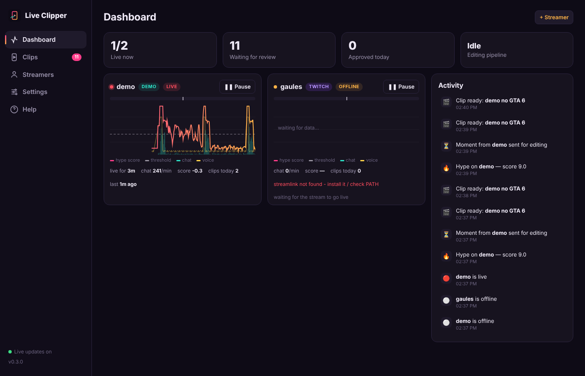
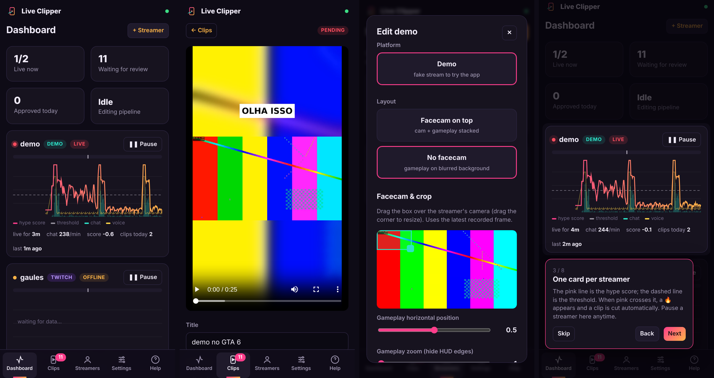

<p align="center">
  
</p>

<h1 align="center">Live Clipper</h1>

<p align="center">
  <b>Turns livestream hype moments into captioned vertical shorts, automatically.</b><br>
  Watches streams · detects chat floods &amp; streamer reactions · AI picks the cut · renders 9:16 with captions · you approve from your phone
</p>

<p align="center">
  
  
  
  
  
</p>

<p align="center"></p>

## Features

- **Live dashboard:** real-time hype charts per streamer, an activity feed, and alerts when a clip is ready.
- **Hot-swappable streamers:** add, pause or remove Twitch/Kick streamers while the app runs. A Demo stream lets you try it with no live channel.
- **Hype detection:** chat floods (unique chatters, hype words) plus streamer voice spikes, each compared against that stream's own recent baseline. Raids and gifted-sub floods are ignored.
- **AI editor:** Claude (on your Pro subscription) decides whether a moment is worth posting and picks the trim, hook, title and hashtags.
- **Rendering:** 1080×1920 with facecam on top, word-by-word captions, a hook card and normalized audio, encoded on the GPU.
- **Phone control:** responsive UI, password login, private access through Tailscale, and Telegram previews.
- **Installers and auto-update:**
  - Windows: setup `.exe` that updates itself.
  - Fedora/Ubuntu: signed dnf/apt repositories built by GitHub Actions.

<p align="center"></p>

## Install

**Windows:** download `Live-Clipper-x.y.z-setup.exe` from the [latest release](../../releases/latest) and run it. No admin rights are needed.

**Fedora**
```bash
sudo curl -fsSL -o /etc/yum.repos.d/live-clipper.repo https://<owner>.github.io/<repo>/rpm/live-clipper.repo
sudo dnf install live-clipper && systemctl --user enable --now live-clipper
```

**Ubuntu / Debian:** instructions are at `https://<owner>.github.io/<repo>/`.

**Then** open <http://127.0.0.1:8787>. The setup wizard walks you through the rest: password, language, system check, first streamer, phone access, then a guided tour.

**Also install:**
- **[Claude Code](https://claude.com/claude-code)**, logged in with your account. It's used to judge moments.
- **FFmpeg** with NVENC.
- **[Tailscale](https://tailscale.com)**, for phone access.

The in-app System check shows what's missing.

## Docs

- [How it works](docs/Live-Clipper-Guide.pdf): every component explained, including the detector math, the AI prompt, rendering, security and tuning.
- [CI/CD, installers & auto-updates](docs/Live-Clipper-CI-CD.pdf): one-time GitHub setup and the release process.

## Development

```bash
uv venv -p 3.12 .venv && uv pip install -r requirements.txt
./run.sh            # Windows: .\run.ps1
pytest -q tests
```

**Release:** `git tag v0.3.0 && git push origin v0.3.0`. GitHub Actions then:
1. Runs the tests.
2. Builds the installer, `.deb` and `.rpm`.
3. Creates the GitHub Release.
4. Updates the apt and dnf repositories.

Installed copies update themselves.

```
web/        server, API, live events, UI (web/static)
watcher/    recording, chat, audio features, hype detector, hot-swap manager
clipper/    transcription, AI plan, rendering, queue, notifications, DB
common/     config, event bus, updater, system checks
packaging/  deb/rpm (nfpm), Windows installer (Inno Setup), launchers
scripts/    CI build + repo publishing      tools/  replay, test_candidate, frame
```
